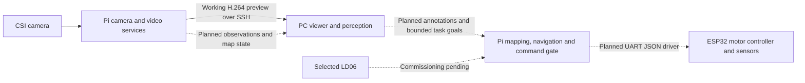

# Rover

An outdoor utility rover project for hauling and towing garden equipment. The
software is being prototyped on a Waveshare UGV02 before transferring its driver
interfaces and autonomy to a larger custom vehicle.

## Start here

Camera streaming and sampled PC scene analysis are the working prototype.
Drive control, mapping, navigation and persistent object memory remain planned.
The profile-driven camera launcher exists in the repository; its updated Pi
deployment still needs verification. See [Feature status](docs/project/FEATURE_STATUS.md)
for the current implementation, acceptance checks and next milestones.

| Read next | What it owns |
| --- | --- |
| [Hardware stack](docs/hardware/HARDWARE_STACK.md) | Selected components, hardware profiles and driver replacement |
| [ROS architecture](docs/architecture/ROS_ARCHITECTURE.md) | Target component ownership, transport, navigation and command authority |
| [Perception and semantic map](docs/architecture/PERCEPTION_AND_SEMANTIC_MAP.md) | Timestamped observations, fast detections, richer annotations and object memory |
| [Pi commissioning guide](docs/hardware/PI5_ROS_ESP32_SETUP_PLAN.md) | Installation, service deployment and hardware verification procedures |
| [PC viewer guide](tools/pc/README.md) | Run the current video and perception prototype |

## How the system fits together

The PC runs visual inference and mission-level decisions. The target Pi stack
owns mapping, localization, navigation, map storage and local motion checks;
the ESP32 handles motor control and onboard sensor feedback. The selected
hardware is a Pi 5, Camera Module 3 Wide, LD06 and UGV02/ESP32 with onboard IMU
and encoders. Ubuntu Server 24.04 ARM64 and ROS 2 Jazzy have passed camera
capture/publication commissioning on the current Pi.

Solid arrows show the working camera path; dashed arrows show future integration.
The proposed perception/map transport uses ROS interfaces through a WebSocket
adapter over SSH. ROS-native PC components can use DDS; the exact manual-control
and task-action transport still needs commissioning. See the architecture for
these separate paths.

In the target design, PC detection supplies quick object sightings; a larger vision-language model
adds richer meaning to selected saved images. The Pi stores validated semantic
records alongside the geometric map. A remembered viewing position is distinct
from a measured object position. Models query that memory and propose bounded
tasks; movement remains under ordinary navigation and the Pi command gate.

## Supporting documents

[Project goals and rationale](docs/project/PROJECT_NOTES.md) explain the staged
utility-rover objective. [Model research](docs/research/ACTION_MODEL_RESEARCH.md)
compares candidates, and [external references](docs/research/EXTERNAL_REFERENCES.md)
index upstream sources. [Archived records](docs/archive/README.md) preserve older
plans and commissioning evidence; they are not current setup instructions.

Hardware verification includes delivered board identity, power/UART wiring,
measured sensor behavior and independent stopping. Before floor tests, validate
command expiry, faults and stops with the wheels raised. The feature checklist
records what still needs to pass before autonomous operation.
