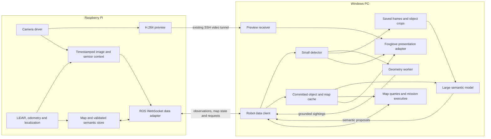

# Video, PC perception and semantic object memory

Reviewed: 2026-10-12. Proposed design, not an implemented or deployed pipeline.
It extends the [ROS architecture](ROS_ARCHITECTURE.md) and incorporates the
two-stage object-annotation approach discussed for this project.

## Recommended division of work

Run both the small detector and the larger semantic model on the PC. The Pi
captures timestamped sensor data, runs geometric mapping/localization, validates
annotation requests and persists the authoritative map and semantic records.
It does not need to run an object detector or a vision-language model.

The small detector produces immediate sightings and candidate object records.
A separate geometry worker on the PC uses measured calibration, source-time
pose and supported ranging evidence to estimate location when possible. The
larger model enriches selected saved sightings with descriptions, attributes,
room/landmark meaning and task relevance. Enrichment runs asynchronously or on
demand; basic object memory does not wait for it.

The viewer, perception workers and mission executive read the same committed
records through a PC cache. The language model queries this memory through
bounded tools and proposes updates; it does not edit occupancy cells or create
metric coordinates. Conventional navigation resolves and executes usable goals.

## Current implementation gaps

| Current component | Gap to resolve |
| --- | --- |
| [Pi video encoder](../../deploy/pi/rover-video.py) | Writes raw pixels to FFmpeg without the ROS image header; the MPEG-TS stream does not preserve that source identity/time |
| [PC receiver](../../tools/pc/camera_analysis.py) | Uses packet-arrival timestamps; these cannot reliably identify the robot pose when the image was acquired |
| PC detection/model loop | YOLO and Qwen execute sequentially; slow Qwen requests delay detection publication and the next pass |
| [Observation adapter](../../tools/pc/qwen_observation.py) | Correctly keeps source/attached-image box coordinates and unknown geometry, but detection IDs are per observation; only eight detections enter the model prompt |
| Optional robot-context file | A recently updated snapshot is not necessarily context for the image being analyzed |
| Camera, LD06 and base | Camera intrinsics uncalibrated; scans, odometry/localization and mounting transforms not yet commissioned |
| [Viewer layout](../../tools/pc/foxglove-layout.json) | Live preview, sampled analysis and JSON only; no persistent objects, map layers or query/write path |

Precise object positions are therefore a future capability, not information the
current pipeline can recover by adding richer prompts. Keep unknown geometry
explicit while building the transport and object-memory interfaces.

The ESP32 controller board includes an onboard ICM-20948 IMU as well as encoder
feedback. Treat wheel-plus-IMU odometry as the planned baseline, subject to
validated telemetry, and LiDAR SLAM as the map-relative correction source.
See [UGV02 telemetry findings](../hardware/UGV02_BASE_TELEMETRY.md) for the vendor
commands and raw-data/orientation caveats. A stop-and-inspect action should check
measured wheel speed/gyro motion and capture source-associated images/scans;
stationarity does not resolve missing object depth.

## Three data paths

Keep the existing H.264 preview for the operator. Send source-timestamped image
samples for perception, and synchronize map/semantic records separately.

This is a target graph, not a claim that every node exists today. Heavy visual
inference and object association stay on the PC. The Pi sampler resolves ROS
context at source time so the Windows PC need not reconstruct it from arrival
times. Its map manager checks evidence and geometric consistency before commits.

| Path | Initial recommendation |
| --- | --- |
| Live preview | Retain commissioned H.264 1280x720 at approximately 20 fps / 2 Mbps; no dependence on inference completion |
| Perception observations | Start at 1 clean JPEG sample/s at source pixel dimensions, bundled with source identity/time and measured context; tune after benchmarking |
| Current pose/health | Independent small updates, initially around 5/s |
| Geometric map | Full snapshot on connect; initially rate-limited full updates for a small map, then revisioned patches/tiles if bandwidth requires them |
| Object sightings | Publish after the small detector/geometry pass, before the large model returns |
| Rich annotations | Event-driven/on-demand proposals, explicit acknowledgements and revisioned committed updates |

The proposed rates are starting targets, not measurements. At 150 kB per JPEG,
1 sample/s is about 1.2 Mbps before overhead; JSON/base64 adds approximately a
third to the image payload. Measure actual JPEG sizes, Pi encoding load and
total traffic. Raw 1280x720 RGB at 30 fps is about 664 Mbps before overhead and
is not the default PC transport.

For the native Windows prototype, use existing
[rosbridge_suite](https://github.com/RobotWebTools/rosbridge_suite/tree/ros2)
for ROS subscriptions and service requests over an SSH-forwarded WebSocket.
This avoids requiring ROS on Windows or writing a new network protocol. Keep
images on a separate connection from map state and RPC so bulky data cannot
stall acknowledgements. Pin/test a Jazzy-compatible bridge/client release;
ROS QoS matching and socket queue limits require actual integration checks.
The [protocol](https://github.com/RobotWebTools/rosbridge_suite/blob/ros2/ROSBRIDGE_PROTOCOL.md)
also supports binary encoding options if JSON becomes a measured bottleneck.

Use ROS sensor-data QoS inside the Pi and bounded, latest-sample queues in the
bridge/client. TCP delivery alone does not guarantee freshness. Resynchronize
after excessive lag rather than processing old queued frames as live input.
Keep writes/query replies reliable, small and request-scoped. Expose the required
perception/map interfaces rather than arbitrary model-facing motor topics.

This revises the earlier DDS-only assumption for Windows perception data.
Future ROS-native PC components can consume the same ROS interfaces over DDS.
Motion commands retain their separate validated path and onboard command gate.
`rosbridge_suite`, Pi `foxglove_bridge`, and the PC Foxglove SDK server are
different components/protocols. Foxglove remains optional for operation.

## Source-time observations and saved object snapshots

Assign observation IDs on the Pi using robot/session/stream epoch and sequence.
An image bundle needs the original ROS image stamp and frame, declared clock
domain/timestamp basis, clean JPEG bytes, source dimensions, calibration and
camera-configuration IDs, map identity/revisions, source-time pose/covariance
and health, and sensor references used for grounding. Missing context has
explicit validity flags/reasons; zero coordinates do not mean unknown.

Lookup transforms at the image timestamp with a bounded wait; do not substitute
the current pose on failure. Freeze resolved context for delayed inference.
[ROS tf2](https://github.com/ros2/ros2_documentation/blob/jazzy/source/Tutorials/Intermediate/Tf2/Learning-About-Tf2-And-Time-Cpp.rst)
supports time-specific transform queries; its live history cannot be assumed
to outlast a cold model request. Obtain covariance from localization, not TF.
Verify what the real camera driver's header stamp represents before describing
it as exposure time. Clock reset/reconnect starts a new stream epoch.

The existing context-file freshness check is insufficient for source association.
Model input should distinguish the observation's frozen pose/map context from
the robot's current state. Synchronize Pi/PC wall clocks for cross-machine age
checks and use local monotonic clocks for worker deadlines.

A saved sighting contains:

- Observation and detection IDs, source stamp and original-pixel bounding box.
- A clean object crop **and its full source image** or immutable image reference.
  The crop supports object attributes; the scene supports room/context meaning.
- Detector label/score/version, optional appearance/track evidence, and rich
  annotation status such as pending, complete or failed.
- Camera calibration/configuration reference, source-time encounter pose and
  map/geometry identity.
- Optional measured position/region, covariance, grounding method and quality;
  otherwise position remains unknown and the encounter viewpoint is retained.

Use a byte/time-limited rolling image cache, initially around 60 seconds, plus
curated durable evidence. When an admitted sighting becomes a candidate, retain
its source image before the rolling cache expires. The Pi can retain selected
captured JPEGs with committed records; the PC caches crops/full frames locally.
Bind image hashes/IDs to records so an enrichment cannot describe a newer crop
under an older location. Manage archival quotas separately from live queues.

## Fast sightings, slower semantic enrichment

Separate preview, reception/cache synchronization, detector and large-model
workers. One inference in flight and one replaceable pending sample per worker
is a reasonable initial policy. Publish the full detector batch promptly even
when only a task-relevant subset fits the large model's prompt.

The small detector records hypotheses such as `cup` immediately. The richer
model can later add `red mug`, visible text, appearance, possible room context
or relevance to the current task. Keep detector score, semantic confidence and
geometric uncertainty separate. Detector/VLM agreement on the same image is
not two independent sightings.

Run enrichment when an object is new, its description is missing or ambiguous,
appearance changes, or a task query needs more detail. Avoid repeatedly sending
unchanged objects to the large model. Prioritize useful, sharp, sufficiently
large views and request another observation if existing evidence is poor.
Select a model based on the task and measured latency; do not require a model
swap to implement this scheduling boundary.

Use source/detection IDs in enrichment proposals. If the object moved before the
model returned, the description still belongs to its historical sighting; it
does not refresh the object's current position or last-seen time. Store inference
completion time separately from observation time. Failures leave basic labels
and object queries available. Additional attributes never grant motion authority.

Maintain source-to-resized/cropped-image coordinate transforms explicitly. The
current analyzed JPEG adds a black summary header and changes the pixel origin;
it is a display artifact, not projection input. The current COCO detector cannot
ground every object a VLM can name. Unboxed descriptions remain scene evidence;
arbitrary-object tasks may later require an open-vocabulary detector/segmenter.

## What location can legitimately mean

Use three levels: image-only sighting; localized encounter/viewing bearing;
and grounded object position/region with uncertainty. Each is useful, but they
support different decisions. Without depth, a search can return to a validated
encounter viewpoint and look again rather than drive to an invented object pin.

For this hardware, the inference is that grounding coverage will be limited:
the RGB camera is monocular and LD06 measures a single plane. A wall behind a
mug can produce a plausible LiDAR return at the mug's image bearing. Objects
below or above the scan plane may have no corresponding return.
[ROS LaserScan](https://github.com/ros2/common_interfaces/blob/jazzy/sensor_msgs/msg/LaserScan.msg)
defines a planar measurement with first-ray timestamp and per-ray timing.

The PC geometry worker must check calibrated point-to-image association,
occlusion/competing boxes, valid range support, scan/image time offset and
robot motion. Use per-ray timing where available or reject associations whose
motion uncertainty is excessive. A single nearest return or model-estimated
distance does not establish object depth.

Ground-plane intersection is possible for a verified floor-contact pixel with
calibrated camera height/pitch and uncertainty, but is invalid for an occluded
contact point or an assumed flat outdoor slope. Multi-view bearings require
adequate viewpoints and a stationary, correctly associated object. Otherwise
retain bearing/viewpoint evidence, inspect again or add depth sensing.
[CameraInfo](https://github.com/ros2/common_interfaces/blob/jazzy/sensor_msgs/msg/CameraInfo.msg)
specifies optical-frame conventions, calibration, distortion and ROI/binning;
geometry must match the actual image configuration.

The Pi validates finite/bounded geometry, evidence references, calibration and
map identity, method/quality and permitted changes. Reproduce/check coordinate
conversion where practical. A large model cannot replace the geometry worker's
measured result with its own XY estimate. Room labels similarly need a measured
region or localized encounter; one image does not define a room polygon.

## Persistent object memory and model tools

Persist semantics separately from occupancy/navigation costmaps on the Pi; an
SQLite store with transactions is a suitable starting point. Records need stable
IDs, labels/attributes, first/last observed times, evidence, optional geometry,
encounter viewpoints, and candidate/confirmed/stale/disputed state. Movable
objects need expiry policy and retained history. An old mug sighting can guide
a search without asserting that the mug remains there.

The map manager owns persistent IDs and admission/association rules; PC tracking
can provide candidate associations. Per-frame detection IDs do not become
persistent IDs automatically. Class equality alone must not merge two mugs,
reprocessing one frame must not count as repeated evidence, and absence from
one image must not delete an object. Ambiguous association stays a candidate.

Separate `map_id`, coordinate/anchor `geometry_epoch`, occupancy `grid_revision`
and `semantic_revision`. Ordinary grid growth need not invalidate all sightings,
but loop closure/relocalization may invalidate projected XY coordinates. Use
SLAM keyframe/submap anchors and reprojection if the mapping stack exposes them;
otherwise invalidate affected positions and reobserve on an epoch change.
Keep source evidence so richer descriptions can survive position invalidation.

Give the model bounded tools via the deterministic PC mission executive:

| Proposed tool | Result / effect |
| --- | --- |
| `get_scene_context(observation_id)` | Frozen source context plus relevant committed records and separately marked current state |
| `find_objects(label, region, max_age, limit)` | Matching records, richness/grounding status, freshness, uncertainty and evidence references |
| `get_object(record_id)` | One record and selected source image/crop references |
| `request_enrichment(record_id, question)` | Schedule richer PC analysis against an identified saved sighting |
| `propose_annotation(record_id, evidence_ids, attributes)` | Submit a validated semantic update bound to existing evidence |
| `request_observation(viewpoint_id)` | Request a bounded inspection through mission logic and ordinary navigation |

Keep the existing Qwen observation-only schema until these tools and validation
are implemented. Feed the model a task-relevant subset of records rather than
the entire grid/history. The viewer is not the model's database.

For `find the red mug`, query known cup/mug candidates. Enrich candidates with
missing colour/detail from saved crops and scene context. Prefer a fresh,
grounded match; otherwise inspect a reachable encounter viewpoint or run a
bounded search. Conventional goal selection checks current traversability and
chooses an observation/approach pose with clearance. Neither an object marker
nor an old image is proof that the route is currently safe or the item present.

## Proposed synchronization interface

Define a small `rover_interfaces` ROS message/service package, reusing standard
image, pose and detection types. These are logical names to implement:

| Interface | Direction and purpose |
| --- | --- |
| `/rover/perception/observations` | Pi -> PC: typed image/context bundle |
| `/rover/perception/submit_sightings` | PC -> Pi service: detection/geometry evidence; admission result and persistent candidate IDs |
| `/rover/map/state` | Pi -> PC: identities, revisions and health |
| `/rover/map/get_snapshot` and `/rover/map/events` | Snapshot plus consecutive committed changes for the PC cache |
| `/rover/map/query` | Bounded object/region queries against committed state |
| `/rover/map/propose_annotation` | PC -> Pi service: richer attributes with evidence and expected revisions |
| `/map` plus a revision envelope | Geometric occupancy grid bound to map ID/epoch/grid revision |

Each write carries request ID, payload hash and expected revisions. Validate
schema, pixel bounds, admitted observation/detection membership, geometry and
evidence quality. Return accepted/candidate/rejected, reason, record IDs and
new revision. Commit deduplication metadata transactionally: a lost
acknowledgement and retry must not create a duplicate object. Changed payloads
under a reused request ID are errors. Conflicts require rereading/re-evaluation.

The PC applies consecutive events only; on a gap/reconnect/restart, fetch a
snapshot and resume at its revision, accounting for events during the fetch.
Display pending proposals separately. Only acknowledged committed annotations
become authoritative model context. A disconnected cache exposes age/status;
do not blindly replay stale writes after map changes or evidence expiry.

## Viewer presentation

Extend the PC Foxglove SDK endpoint to present data from the same committed cache
used by models. Retain unsynchronized live video; add a clean sampled image and
separate timestamp-matched `ImageAnnotations`. Publish the sampled image and
matching detector annotations together, including empty results. Show rich-model
output separately, labelled with its original observation and completion time.
Do not freeze the live preview waiting for semantic enrichment.
[Foxglove ImageAnnotations](https://docs.foxglove.dev/docs/sdk/schemas/image-annotations),
[image timestamp synchronization](https://docs.foxglove.dev/docs/visualization/panels/image#timestamp-synchronization).

Use a top-down **3D panel** for occupancy grids, robot pose and semantic markers,
not the geographic Map panel for an indoor occupancy map. Convert ROS occupancy
data to `foxglove.Grid`, preserving origin/orientation, resolution and unknown
cells; committed object records become `SceneUpdate` entities with stable IDs
and confidence/freshness metadata. Render encounter viewpoints separately from
grounded object pins. Emit deletions/resets when records retire or maps change.
These are presentation conversions, not a second mapper.
[Foxglove 3D panel](https://docs.foxglove.dev/docs/visualization/panels/3d),
[Grid](https://docs.foxglove.dev/docs/sdk/schemas/grid),
[SceneUpdate](https://docs.foxglove.dev/docs/sdk/schemas/scene-update).

Verify schema and synchronization behavior against the installed Foxglove 3.3.0
and Python SDK; current upstream documentation may describe newer behavior.
A future task-focused operator app can read the same cache/API. Map queries and
PC inference must work with Foxglove closed.

## Implementation sequence and acceptance

1. Separate detector and large-model workers; demonstrate prompt detection
   results with a deliberately slow/failed model.
2. Implement source-time image/context bundles and the Windows transport;
   measure latency/queues/bandwidth/CPU and preserve image-only operation when
   pose/calibration is absent. Replay motion to catch arrival-pose mistakes.
3. Implement candidate sightings, curated image/crop evidence, semantic queries
   and asynchronous enrichment. Test identical retry, conflicting edits, moved
   objects and enrichment bound to an older snapshot. Positions may stay unknown.
4. Commission LD06, odometry/localization, camera intrinsics and sensor mounts;
   validate grounding against known objects and report measured error. Ambiguous
   wall returns, below-plane objects and invalid calibration stay unpositioned.
5. Add map/object viewer layers and verify reset, marker deletion, cache recovery
   and SLAM-coordinate corrections; preserve rich labels when geometry expires.
6. Connect queries/enrichment to bounded inspection/search/navigation tasks.
   Verify that stale sightings trigger reacquisition rather than assumed presence.

Record source images, transforms/scans, detections, proposals and commit results
with clock domains/revisions for deterministic replay. Video alone cannot
reproduce grounding errors. No runtime changes are made by this design document.
