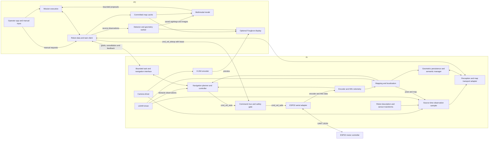

# Rover ROS 2 architecture

Reviewed: 2026-10-12. This is the authoritative **target architecture** for the
UGV02 prototype, not evidence that every component is running. Use
[Feature status](../project/FEATURE_STATUS.md) for implemented/deployed behavior,
[hardware stack](../hardware/HARDWARE_STACK.md) for parts and driver selection,
and the [Pi guide](../hardware/PI5_ROS_ESP32_SETUP_PLAN.md) for procedures.

## Responsibilities and selected direction

| Component | Runs where | Owns |
| --- | --- | --- |
| Camera and LiDAR drivers | Pi | Sensor acquisition, timestamps and hardware-specific conversion |
| Base serial adapter | Pi | One ESP32 UART connection; bounded command translation and encoder/IMU/status publication |
| Odometry estimator | Pi | Short-term robot pose/velocity from verified encoder and onboard IMU measurements |
| Mapping/localization | Pi | Geometric map, map-relative pose and corrections to accumulated motion error |
| Navigation | Pi | Geometric goals, routes, local obstacle handling and motion requests |
| Command mux/safety gate | Pi | Manual/autonomy ownership, command freshness, limits and stopping |
| Semantic map manager | Pi | Validated persistent object/room/landmark records and evidence references |
| Detector and geometry worker | PC | Fast visual sightings and measured object-location hypotheses where supported |
| Multimodal model | PC | Richer image interpretation, task meaning and bounded semantic/action proposals |
| Mission executive | PC | Task state, map queries, proposal validation, goal sequencing, cancellation and recovery |
| Viewer/operator application | PC | Present committed state and accept operator input |
| ESP32 firmware | Controller board | Motor loop, encoder/IMU acquisition and firmware watchdog |

**Onboard mapping, localization and navigation are the planned deployment.**
Evaluate SLAM Toolbox for 2D mapping, Nav2 for navigation and `robot_localization`
for encoder/IMU fusion. These packages are candidates to commission, not installed
or performance-validated parts of this rover. Measure Pi load with camera/video
running before fixing their configuration.

The target includes one small detector and one multimodal model on the PC;
no separate language-model decision service is required. The running model and
research candidates are distinguished in [model research](../research/ACTION_MODEL_RESEARCH.md).
Detailed object-memory and enrichment behavior belongs in the
[perception design](PERCEPTION_AND_SEMANTIC_MAP.md).

## Current transport and planned transport

The working prototype streams H.264 MPEG-TS through SSH to native Windows Python.
That process decodes sampled images, runs detection/description and publishes a
local Foxglove endpoint. Pi ROS discovery is currently localhost-scoped; PC
visualization does not require a ROS installation or LAN DDS discovery.

| Path | Direction | Transport and status |
| --- | --- | --- |
| Live preview | Pi -> PC | Existing H.264 TCP stream through SSH; receipt timestamps, not source-time grounding |
| Perception observations | Pi -> PC | Planned ROS image/context bundles through `rosbridge_suite` WebSocket over SSH |
| Map state, queries and annotation commits | Pi <-> PC | Planned ROS topics/services through the same data adapter, with separate connections for bulky images and small state/RPC |
| Navigation goals, cancel and feedback | PC mission <-> Pi task interface | Planned bounded ROS actions/interface; exact Windows transport and wire contract still to select and test |
| Manual velocity requests | PC teleoperation -> Pi gate | Planned stamped/leased command interface; native DDS is an option for ROS-native PC nodes; Windows input/transport still to select |
| Hardware commands/feedback | Pi <-> ESP32 | Planned base adapter over verified UART JSON |
| Diagnostics | Pi or PC -> Foxglove | Pi `foxglove_bridge` and/or PC SDK server; optional for robot operation |

ROS interfaces define the robot's data and actions; DDS is not the transport for
every cross-machine path. The proposed perception/map bridge is distinct from
both `foxglove_bridge` and the PC Foxglove SDK server. Native ROS PC components
may use DDS against the same robot interfaces. Test the selected bridge version,
QoS, queue bounds, reconnect behavior and timestamp handling before deployment.
The perception transport does not itself select or implement a motion transport.

## Target node and data graph

This graph shows logical responsibilities. Except for the documented camera,
video and diagnostic prototype, these paths need implementation/commissioning.
Names describe interfaces, not a complete installed ROS launch graph.

The operator app is a future task-focused interface: conversational requests,
manual driving, map/camera/status and active control ownership. Foxglove is the
current development viewer and remains optional for runtime operation. It reads
presented data; it is neither the map database nor part of the command authority.

## Maps, localization and sensor frames

The Pi mapping stack owns the geometric map and localization. The Pi semantic
manager persists validated records beside that map, with a committed PC cache.
PC perception computes hypotheses from frozen source-time observations; its
language model enriches meaning without inventing metric positions. See the
[semantic design](PERCEPTION_AND_SEMANTIC_MAP.md#persistent-object-memory-and-model-tools)
for evidence, object IDs, revisions, freshness and SLAM correction handling.

| Transform | Authoritative publisher | Meaning |
| --- | --- | --- |
| `map -> odom` | Mapping/localization | Map-relative correction to accumulated odometry error |
| `odom -> base_link` | One odometry estimator | Continuous local robot motion estimate |
| `base_link -> lidar_link`, IMU and camera frames | Robot description/state publisher or one explicitly owned static-transform source | Measured sensor mounts and optical-frame conventions |

`robot_state_publisher` uses the robot description and joint state to publish
robot geometry; it does not consume `/odom` to estimate robot motion. Camera
intrinsics belong to the camera calibration, while camera mounting transforms
belong to the robot frame description. Keep one owner for each transform.

Wheel/IMU odometry and LiDAR scan matching work together: the former provides
short-term motion estimates; SLAM refines map-relative pose and extends/refines
the map. A stopped image/scan observation can improve object association, but
stationarity cannot create depth outside the LiDAR scan plane. The selected
sensors and firmware conversion constraints are in
[UGV02 base telemetry](../hardware/UGV02_BASE_TELEMETRY.md).

## Command authority and bounded robot actions

There is one path to drive output:

`manual or navigation request -> command mux/safety gate -> base adapter -> ESP32`

The gate selects the active manual/autonomy owner, bounds commands and checks
freshness, health and arming. It emits a stop on timeout, fault or lost ownership.
The base adapter alone translates accepted commands to the verified controller
protocol. The ESP32 retains its motor loop and watchdog; any independent physical
stop overrides the software path. Do not republish stale commands to refresh a
lease or defeat the controller timeout.

The PC mission executive validates model proposals, manages deadlines and
bounded retries, and monitors action feedback. The Pi action interface checks
local readiness and permits only supported tasks. Movement does not wait for
model inference or viewer rendering. A missing destination can trigger bounded
inspection/exploration only when mapping/localization/navigation are valid;
operator escalation follows exhausted recovery or a blocking health condition.

| Proposed skill | Parameters | Execution owner |
| --- | --- | --- |
| `RotateRelative` | Angle, speed bound, deadline | Pi action/navigation layer |
| `NavigateToPose` | Map-frame pose, tolerance, deadline | Pi navigation |
| `ScanSector` | Angular range, observation steps/duration | Pi bounded inspection skill |
| `Stop` / `CancelTask` | Active task ID | Pi stop/action path and PC mission logic |
| `ReportObservation` | Existing evidence IDs and semantic fields | PC perception/mission logic and Pi annotation validator |

These are proposed capabilities, not implemented ROS action definitions. Every
motion action needs feedback, cancellation and a defined failure result. The
model may select a task; it does not publish motor PWM, UART frames or continuous
velocity. Reachability and current obstacle handling belong to navigation.

## ROS interface boundaries

Topic names are logical contracts. Select message types, rates and QoS during
implementation; a plain `Twist` has no timestamp, so remote motion requires a
stamped command or an explicit lease/timestamp envelope.

| Interface | Owner / scope |
| --- | --- |
| `/camera/image_raw`, `/camera/camera_info` | Pi camera acquisition/calibration; raw images stay local by default |
| `/scan` in `lidar_link` | Pi LiDAR adapter; standard `sensor_msgs/msg/LaserScan` |
| `/imu/data` (proposed) | Pi base adapter after verified units, axes and timing |
| Wheel feedback / `/joint_states` where supported | Pi base adapter; one ESP32 serial reader |
| `/odom`, `odom -> base_link` | Pi odometry estimator; pose/velocity with uncertainty |
| `/map`, `map -> odom` | Pi mapping/localization; map identity/revision envelope for PC synchronization |
| `/cmd_vel_teleop`, `/cmd_vel_auto` | Separate manual and local navigation inputs to the gate |
| `/cmd_vel_safe` | Sole gate output consumed by the base adapter |
| Base status / `/diagnostics` | Pi drivers and health monitoring |
| Task goals/cancel/feedback | Validated PC-to-Pi task interface; exact definitions open |
| Source observations, map queries and annotation services | Defined in the [perception/map contract](PERCEPTION_AND_SEMANTIC_MAP.md#proposed-synchronization-interface) |

Hardware-specific serial framing, commands, units and conversion belong in the
base adapter and [telemetry notes](../hardware/UGV02_BASE_TELEMETRY.md). Driver
selection/configuration belongs in the [hardware profile](../../config/hardware/ugv02-pi5.json).
Do not add sensor-model branches to mapping, navigation or PC task logic.

## Failure behavior and runtime startup

These are required target behaviors to verify, not guarantees of the current
prototype.

| Failure | Required response |
| --- | --- |
| PC/link or command lease lost | Pi ends remote authority, cancels/stops affected movement and rejects old queued requests |
| Model slow/unavailable | Detector, map queries and ordinary navigation remain independent; mission logic bounds waiting/recovery |
| Pose or required sensor invalid | Reject dependent navigation/grounding; retain clearly marked image-only/historical evidence where appropriate |
| UART fault or malformed feedback | Report fault; gate stops and blocks drive output |
| Gate/driver crash or Pi power loss | Verified ESP32 watchdog and independent physical stop provide the remaining stop paths |
| Viewer closes | Robot state and control do not depend on the viewer |
| Physical stop activated | Independent propulsion inhibition overrides software |

Runtime startup should load hardware/calibration, start sensor/base feedback with
motion inhibited, establish frame/odometry/localization health, and bring up
navigation plus the command gate disarmed. Arm an explicit control owner only
after local readiness and its command lease are valid. This lifecycle is distinct
from the project's build order, maintained in
[Feature status](../project/FEATURE_STATUS.md#suggested-next-sequence).

## Decisions still open

- Delivered board/firmware, UART wiring/device mapping and measured telemetry conversion.
- Camera intrinsics and sensor mounts; source timestamp accuracy and synchronization.
- Mapping/fusion/navigation package configuration and Pi performance under combined load.
- Windows manual-input and task-action transport, message schemas, leases and arming interface.
- Operator app framework, model/runtime selection and measured task accuracy.
- Prototype independent physical stop and mobile power validation.

Ubuntu/Jazzy camera capture/publication has passed on the commissioned Pi. Fresh
installs must repeat that acceptance test. The profile-driven service revision,
base/LiDAR integration, mapping and motion acceptance remain tracked in the
feature checklist. Dated evidence is in the [archive](../archive/README.md).

## Terms used here

- **Odometry:** short-term estimate of robot movement and velocity, which can drift.
- **SLAM:** builds a geometric map while estimating the robot's place in it.
- **TF:** timestamped transforms between robot, sensor and map coordinate frames.
- **Semantic map:** labels and evidence about objects/places associated with geometry.
- **Action:** bounded work with progress, cancellation and a completion/failure result.

The diagrams are Mermaid source and render in compatible Markdown viewers.
