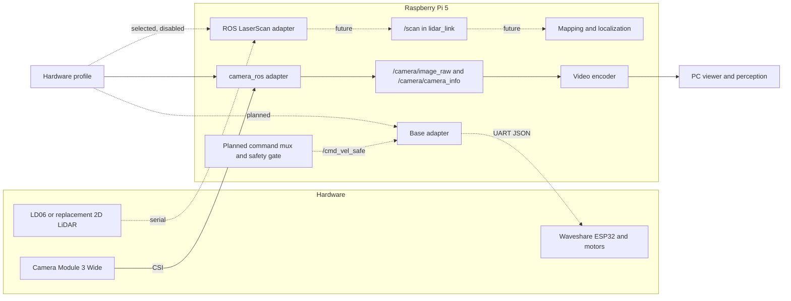

# Hardware stack and replaceable drivers

The rover's hardware selection lives in
[`config/hardware/ugv02-pi5.json`](../../config/hardware/ugv02-pi5.json).
This is a runtime profile, not just a parts list: the repository camera launcher
reads its driver and capture parameters from it. Deployment acceptance is tracked
in [Feature status](../project/FEATURE_STATUS.md). Hardware consumers use shared ROS
[interface constants](../../deploy/pi/rover_hardware/contracts.py), rather than
depending on the sensor model or its serial protocol.

## Selected prototype

| Role | Selected hardware | Connection | Current state |
| --- | --- | --- | --- |
| Onboard compute | Raspberry Pi 5 | Local ROS 2 Jazzy on Ubuntu Server 24.04 ARM64 | Commissioned |
| Camera | Raspberry Pi Camera Module 3 Wide | CSI, `camera_ros` | Streaming commissioned; calibration and mounting transform still needed |
| 2D LiDAR | LD06 | Serial; wiring and device path to verify | Selected; no installed/working driver recorded; disabled in the profile |
| Base and motor controller | Waveshare UGV02 6x4 and ESP32 | UART JSON | Board/firmware commissioning, driver and safety gate pending |
| Onboard inertial sensing | ICM-20948 9-axis IMU on the ESP32 controller board | Shared ESP32 UART telemetry | Documented hardware; ROS publication, sensor scaling/timing and fusion pending |
| Remote compute | Development PC | Wi-Fi/LAN, currently SSH video transport | Viewer and local vision prototype; [PC profile](DEVELOPMENT_PC_PROFILE.md) |
| Power | Separate rated Pi bench supply; chassis battery arrangement to validate | Electrical power | Mobile supply and independent physical stop still to validate |

LD06 is the selected 2D LiDAR. Selection does not establish receipt, mounting,
electrical compatibility, driver compatibility or successful scan publication.
Historical inventory and commissioning evidence
remain in the [archived handoff](../archive/ROVER_HANDOFF_2026-10-04.md) and
[dated commissioning record](../archive/COMMISSIONING_2026-10-11.md). Current
procedures live in the [Pi guide](PI5_ROS_ESP32_SETUP_PLAN.md).

The [IMU and encoder telemetry notes](UGV02_BASE_TELEMETRY.md) record the vendor
commands, upstream firmware details and planned wheel-plus-IMU odometry. These
onboard sensors are recorded under the base in the runtime profile and share
its future serial adapter.



Solid paths have repository implementations; dashed paths need commissioning
or implementation. The camera stream was commissioned before the profile migration;
this diagram does not establish deployment of the updated launcher.
This diagram is for GitHub documentation. It does not add an operator UI feature.

## Hardware-independent interfaces

| Capability | Contract | Hardware-specific responsibility |
| --- | --- | --- |
| Camera | `/camera/image_raw`: `sensor_msgs/msg/Image`; `/camera/camera_info`: `sensor_msgs/msg/CameraInfo` | Capture, encoding, timestamps, intrinsics and camera frame |
| 2D scan | `/scan`: `sensor_msgs/msg/LaserScan`, frame `lidar_link` | Serial protocol, ranges in metres, angles in radians, valid timestamps, scan timing and frame configuration |
| Mobile base (planned) | Safe velocity input `/cmd_vel_safe`, odometry `/odom`, health/status | Controller protocol, feedback conversion and calibrated drivetrain geometry; see [ROS architecture](../architecture/ROS_ARCHITECTURE.md) |

Use sensor-data QoS for camera/scan consumers. A LiDAR driver must expose a
compatible QoS and a verified `LaserScan`; remapping a topic does not convert
message types, units or timing. Robot-description/TF ownership must publish the
measured `base_link -> lidar_link` mounting transform before mapping uses scans.
Camera and base frame/TF ownership remain as described in the ROS architecture.

The LD06-specific protocol belongs in its ROS driver. Mapping, navigation and
PC perception should depend on `/scan`, not on `LD06`, its UART baud rate or its
vendor topic name. Replacing a 2D LiDAR that meets this contract should require
profile/dependency changes and mounting calibration. A replacement with a
different capability, such as a 3D point cloud, may need a conversion adapter
or changes to the mapping design.

## What the Pi code does now

[`rover_hardware`](../../deploy/pi/rover_hardware/) separates profile validation,
interface constants, the explicit adapter registry and individual drivers.

- `drivers/camera_ros.py` launches the existing commissioned ROS camera node
  with parameters from the profile. The repository camera service uses this path;
  the updated Pi deployment still needs verification.
- `drivers/ros_laserscan.py` launches a configured ROS node and maps its source
  scan topic and frame parameter to the common contract. It does not implement
  the LD06 serial protocol. Package, executable, source topic and frame parameter
  are deliberately unset until a real driver is verified.
- The video encoder imports the camera topic constant. It has no camera model
  selection logic.
- Disabled devices cannot be launched. Enabling an incomplete profile fails
  validation. There is no base adapter or motion implementation yet.

The `enabled` flag permits an individual device to run; it does not automatically
start services. Each service has its own lifecycle. No all-devices launcher
starts motors as a side effect of starting a sensor.

## Inspect a profile

From the repository root, inspect the profile without ROS or hardware:

```powershell
$env:PYTHONPATH = "$PWD/deploy/pi"
python -m rover_hardware --profile config/hardware/ugv02-pi5.json describe
python -m rover_hardware --profile config/hardware/ugv02-pi5.json check
python -m rover_hardware --profile config/hardware/ugv02-pi5.json command camera
python -m unittest discover -s deploy/pi -p 'test_*.py' -v
```

`command camera` prints the configured launch command without starting a device.
`run camera` executes it in a prepared Pi ROS environment. Validation can confirm
the profile shape and enabled driver settings, not physical sensor operation.

The [Pi deployment procedure](PI5_ROS_ESP32_SETUP_PLAN.md#deploy-the-camera-services-on-the-commissioned-pi)
owns installation and service commands. It installs code under `/opt/rover` and
an initial active profile at `/etc/rover/hardware.json`, preserving that local
profile on subsequent installs. Pulling Git does not itself change the active
profile. Apply tracked profile changes deliberately through that procedure.

`ROVER_HARDWARE_PROFILE` selects an alternate profile. `ROVER_CAMERA_SETUP` and
`ROVER_LIDAR_SETUP` select ROS workspace overlays. Set these in the affected
systemd service environment for service use; a shell-only export is not persistent
service configuration. The current units/installer still target the commissioned
`barry` user and camera workspace.

## Commission the LD06 or swap a LiDAR

1. Install and verify a suitable ROS driver on the Pi. Check the actual device's
   wiring, stable serial path, baud rate, required permissions and power. Prefer
   a persistent device path rather than relying on `/dev/ttyUSB0` enumeration.
2. In `devices.lidar`, record the selected model and connection. Set
   `driver_config.package`, `executable`, absolute `scan_topic` and the driver's
   `frame_parameter` name. Put its serial settings and other parameters in
   `driver_config.parameters`. The adapter supplies `lidar_link` as the frame.
3. Set `enabled` to `true` and validate/inspect the generated command. Driver
   dependencies must be installed separately; profile validation does not prove
   that the ROS package exists or the device works.
4. Apply the profile on the Pi, set an overlay via a service drop-in if needed,
   then enable/start `rover-lidar.service`. Verify message type, metres/radians,
   timestamps, scan timing, QoS, transform, disconnect behavior and real scans.
5. Record the commissioning result and update the tracked profile and this
   hardware inventory. Consumers continue using `/scan` and `lidar_link`.

If a driver needs a launch file, custom protocol or message conversion, add a
small dedicated module under `rover_hardware/drivers/` and register its ID in
`drivers/__init__.py`. Keep those details behind the same capability contract.
Do not put sensor-model conditionals into mapping or perception code.

Mapping/navigation and a live LD06 stream are still future integrations. The
automated checks exercise profile selection and adapter boundaries using
fictional sensor packages; they are not LD06 hardware acceptance tests.
